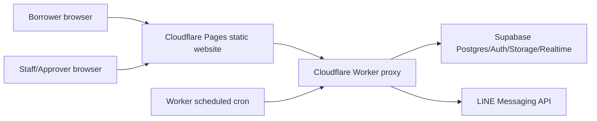
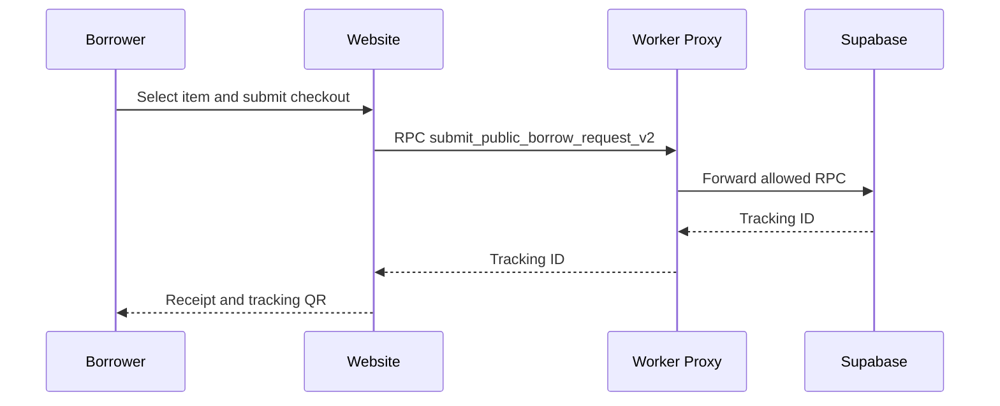
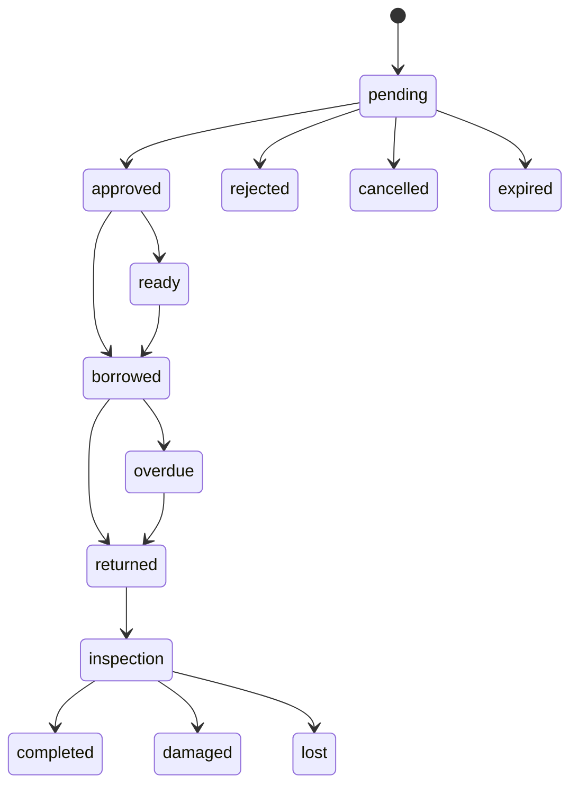

# SIMSET Borrow Production Readiness Audit

Date: 2026-07-28  
Repository: `D:\Jedi_EX_HDX_BAC01\01.Jedi_SIMSET\SIMSET_Project\SIMSET_ModelSystem`  
Branch under review: `main`  
Decision: `NO-GO`

This report is based on repository inspection and selected runtime checks. It does not treat prior audit reports, planning documents, or developer claims as proof. Production deployment was not performed.

## 1. Executive Summary

Claim: SIMSET Borrow is not production-ready today.  
Evidence: local static smoke checks pass, but the live Worker verification fails with `Expected public equipment endpoint to be reachable, got 404`, Cloudflare Worker secret inventory returned `[]`, `npm run verify:phase2` fails due to contract drift, and the working tree is dirty with many untracked SQL and documentation files.  
Reproduction:

```powershell
npm run verify:current-mvp
npm run smoke:main-pages
npm run smoke:deploy-workflow
npm run verify:live-worker
npm run verify:phase2
git status --short
```

Affected component: Cloudflare Worker, release hygiene, Supabase contract tests, production validation.  
Confidence: High.  
Remaining uncertainty: Live Supabase RLS and concurrent booking behavior were not fully tested because the live Worker is not currently reachable through the expected verification endpoint.

Critical blockers:

| ID | Severity | Finding | Evidence |
|---|---:|---|---|
| P0-01 | P0 | Live Worker/proxy is not production-verifiable | `npm run verify:live-worker` returned 404 |
| P0-02 | P0 | Worker secrets appear absent in current Cloudflare context | `npx wrangler secret list` returned `[]` |
| P0-03 | P0 | Core transaction tables are not shown as RLS-enabled in canonical SQL | `rg "ALTER TABLE public.borrow_requests ENABLE" supabase/current_mvp_release.sql` returned no match |
| P1-01 | P1 | No live end-to-end evidence for request -> approve -> pickup -> return -> audit | Only local mocked smoke tests passed |
| P1-02 | P1 | Repository is not release-clean | `git status --short` shows modified and untracked files |
| P1-03 | P1 | Phase 2 contract test is stale or failing | `verify:phase2` expects `submit_borrow_request`, current frontend uses `submit_public_borrow_request_v2` |

## 2. Scope and Limitations

In scope:

- Repository identity and current architecture reconstruction.
- Static frontend, Worker, Supabase SQL, workflow, security, release hygiene, and test inventory.
- Local test and smoke execution.
- Live Worker verification using existing project scripts and Wrangler.

Out of scope in this run:

- Production deployment.
- Production data mutation.
- Full destructive or concurrency tests against production data.
- Direct live Supabase policy testing with real anon/authenticated JWTs, because the live Worker verification currently fails.
- Formal ISO certification.

## 3. Repository Identity

Commands run:

```powershell
pwd
git remote -v
git branch --show-current
git status --short
git log --oneline --decorate -n 15
git tag --list
```

Observed identity:

| Item | Evidence |
|---|---|
| Path | `D:\Jedi_EX_HDX_BAC01\01.Jedi_SIMSET\SIMSET_Project\SIMSET_ModelSystem` |
| Remote | `https://github.com/BPET17051/SIMSET_ModelSystem.git` |
| Branch | `main` |
| Latest commit | `f891713 docs: tighten production release preflight` |
| Tag | `v2026.06.28-mvp.1` |
| Working tree | Dirty, with modified workflow/security files and many untracked docs, scripts, and SQL files |

Package and framework:

| Item | Evidence |
|---|---|
| Package manager | `package-lock.json`, `npm` scripts in `package.json` |
| Framework | Static HTML/CSS/JS, not React |
| Frontend root | `website/` |
| Worker root | `cloudflare-worker/` |
| Canonical SQL | `supabase/current_mvp_release.sql` per `supabase/MIGRATION_ORDER.md` and `docs/RELEASE_SOURCE_SET.md` |
| CI/CD | `.github/workflows/deploy-production.yml`, `frontend-smoke.yml`, `generate-data.yml` |
| Deployment target | Cloudflare Pages for `website`; separate Cloudflare Worker for proxy |

Claim: Prior React-specific audit risks do not match the current application architecture.  
Evidence: `rg "React|StrictMode|BrowserRouter|KpiHeader|ModelDetail|/model" .` found no React app/router components in the active static app.  
Component: Architecture reconciliation.  
Confidence: High.  
Uncertainty: Legacy folders may contain old experiments, but they are not the active runtime per release source documentation.

## 4. Actual Architecture

### System Context



### Container Diagram

| Container | Evidence | Responsibility |
|---|---|---|
| Static website | `website/*.html`, `website/js/*.js`, `website/css/simset-borrow.css` | Catalog, cart, checkout, tracking, history, approver, staff, report |
| Worker proxy | `cloudflare-worker/worker.js`, `cloudflare-worker/wrangler.toml` | Supabase proxy, CORS, rate limit, allowlist, LINE dispatch, cron |
| Supabase database | `supabase/current_mvp_release.sql` | Tables, RPCs, triggers, status machine, audit, snapshots |
| Supabase Storage | `condition-snapshots` bucket in SQL | Pickup/return photos |
| GitHub Actions | `.github/workflows/*.yml` | Smoke checks and Cloudflare Pages deploy |

### Component Diagram

| Component | Files | Status |
|---|---|---|
| Catalog | `website/index.html`, `website/js/catalog.js` | Implemented, local-smoke verified |
| Checkout | `website/checkout.html`, `website/js/checkout.js` | Implemented, local-smoke verified |
| History and identity claim | `website/history.html`, `website/js/history.js`, `claim_borrow_request_identity` | Implemented in code, live unverified |
| L1 approval | `website/approver.html`, `website/js/approver.js`, `get_l1_approval_queue` | Implemented in code, live unverified |
| Staff dashboard | `website/staff.html`, `website/js/staff.js`, `get_staff_dashboard_orders` | Implemented in code, local-smoke verified |
| Pickup/return snapshots | `website/js/staff.js`, `confirm_pickup_with_snapshot`, `confirm_return_with_snapshot` | Implemented in code and SQL |
| Worker proxy | `cloudflare-worker/worker.js` | Implemented, live verification failed |

### Data Flow



### Trust Boundaries

| Boundary | Risk |
|---|---|
| Browser to Worker | User input, forged requests, duplicate submits, upload content |
| Worker to Supabase | Service/anon key handling, allowlist correctness, cache behavior |
| Authenticated browser to RPC | JWT role claims must be enforced in SQL, not UI only |
| Storage upload | File type and object path must be restricted |
| Notification dispatch | Worker secret and LINE token must not leak |

### Deployment Diagram

Cloudflare Pages deploy is configured in `.github/workflows/deploy-production.yml`. Worker deployment is not part of that workflow and must be deployed/verified separately before frontend production release.

## 5. Research-Based Target Model

Target model from the supplied benchmark:

- Physical asset identity must be immutable and separate from display names.
- Availability must be transaction-based, not only manually edited text status.
- State transitions must be enforced by backend/database logic.
- UI visibility must not be treated as authorization.
- Pickup and return must be evidence-backed with photos, notes, and atomic status changes.
- Audit logs must be immutable for ordinary users.
- Notifications are useful but are not the source of truth.
- Release readiness requires reproducible staging and production validation.

Current MVP partially follows this model through UUID primary keys, SAP/unit business keys, RPC-based status transitions, audit tables, and condition snapshots. It does not yet fully satisfy production-grade requirements around live RLS verification, Worker readiness, concurrency testing, repair linkage, notification validation, and release hygiene.

## 6. Current Feature Inventory

| Feature | Classification | Evidence |
|---|---|---|
| Asset catalog | IMPLEMENTED_AND_VERIFIED locally | `website/index.html`, `catalog.js`, `smoke:main-pages` |
| Product detail | IMPLEMENTED_AND_VERIFIED locally | `product-details.html`, smoke route |
| Search/filter | IMPLEMENTED_BUT_UNTESTED live | `catalog.js`, smoke route only |
| Pagination | NOT_IMPLEMENTED for catalog | No active pagination component found |
| Cart | IMPLEMENTED_AND_VERIFIED locally | `cart.html`, `cart.js`, smoke route |
| Guest request creation | IMPLEMENTED_BUT_LIVE_UNTESTED | `submit_public_borrow_request_v2`, `checkout.js` |
| Optional borrower email | IMPLEMENTED_BUT_LIVE_UNTESTED | `checkout.js`, SQL RPC parameter |
| Identity claim | IMPLEMENTED_BUT_LIVE_UNTESTED | `history.js`, `claim_borrow_request_identity` |
| My History | IMPLEMENTED_BUT_LIVE_UNTESTED | `history.js`, `get_my_borrow_requests` |
| L1 approval | IMPLEMENTED_BUT_LIVE_UNTESTED | `approver.js`, `approver_l1_decide_request` |
| Reject with reason | IMPLEMENTED_BUT_LIVE_UNTESTED | SQL transition requires reason for reject/cancel |
| Staff Kanban | IMPLEMENTED_BUT_LIVE_UNTESTED | `staff.js`, `get_staff_dashboard_orders` |
| Pickup snapshot | IMPLEMENTED_BUT_LIVE_UNTESTED | `confirm_pickup_with_snapshot` |
| Return snapshot | IMPLEMENTED_BUT_LIVE_UNTESTED | `confirm_return_with_snapshot` |
| Manikin exact assignment | IMPLEMENTED_BUT_LIVE_UNTESTED | `staff_assign_manikin_to_item` |
| Equipment unit assignment | IMPLEMENTED_BUT_LIVE_UNTESTED | `staff_assign_inventory_unit_to_item` |
| Kit return/refill task | PARTIALLY_IMPLEMENTED | `kit_refill_tasks`, return RPC creates tasks for abnormal return |
| Overdue scheduled job | DATABASE_ONLY | `mark_overdue_borrow_requests`, `pg_cron`, Worker scheduled hook |
| LINE notification | PARTIALLY_IMPLEMENTED | Worker and outbox exist, secrets absent and live dispatch unverified |
| Reports/KPI | IMPLEMENTED_BUT_LIVE_UNTESTED | `report.js`, `get_kpi_report` |
| Audit logs | DATABASE_ONLY | `borrow_request_status_audit`, `audit_logs`; no viewer |
| Repair linkage | PARTIALLY_IMPLEMENTED | Damage/lost statuses exist; full repair job lifecycle absent |
| Damage/loss | PARTIALLY_IMPLEMENTED | Return RPC maps abnormal condition to `damaged` or `lost` |
| Admin legacy page | PARTIALLY_IMPLEMENTED/LEGACY | `admin.html`, `admin.js`; can confuse staff workflow |
| CSV export | NOT_VERIFIED | No active export evidence gathered |
| Accessibility | PARTIALLY_IMPLEMENTED | Smoke exists for keyboard nav, not run in this audit |

## 7. Audit-to-Repository Reconciliation

| Prior/suspected claim | Result | Evidence |
|---|---|---|
| React route `/model/:code` missing | NOT APPLICABLE | Active app is static HTML, no React router |
| `KpiHeader` callback mismatch | NOT APPLICABLE | No `KpiHeader` component found |
| Duplicate React Navbar | NOT APPLICABLE | No React root/layout |
| Frontend direct Supabase access | PARTIALLY FALSE | Frontend uses Worker URL and placeholder key in `supabase-client.js` |
| Admin legacy behavior | CONFIRMED RISK | `admin.html` remains active and differs from `/staff` and `/approver` |
| Worker must be deployed before frontend | CONFIRMED | Docs and frontend RPCs require Worker allowlist |

## 8. Known Risk Verification

| Risk | Result | Evidence | Action |
|---|---|---|---|
| A Missing model route | Not applicable | No React router; no active `/model/:code` route | Do not fix React route |
| B KPI callback mismatch | Not applicable | No React `KpiHeader` | Do not fix React props |
| C Duplicate Navbar | Not applicable | Static pages render own nav | Standardize nav separately |
| D Direct Supabase access | Unresolved security risk | Browser points to Worker proxy, but Worker allowlists table paths | Test RLS and consider removing raw table paths |
| E Weak query error handling | Partially confirmed | JS uses error checks in main RPC paths; full Promise.all repair detail risk not applicable | Continue targeted review |
| F CSV injection | Unknown | Active CSV export not verified | Add test if CSV feature is enabled |
| G Pagination edge case | Not applicable/currently absent | No active pagination evidence | Reassess when implemented |
| H Realtime request storm | Confirmed | `staff.js` reloads board on every `borrow_requests` change | Debounce/abort/reconcile |
| I React StrictMode effects | Not applicable | Static app | No action |
| J Schema drift | Confirmed risk | Failing `verify:phase2`, many untracked SQL files | Establish canonical migrations |

## 9. Borrow Workflow Assessment

Implemented MVP workflow:



Implemented transition table:

| Current | Next | Actor | Required data | Side effects | Audit | Compensation |
|---|---|---|---|---|---|---|
| pending | approved | approver_l1/admin | actor id | approval timestamps; staff notification outbox possible | status audit | transition can later be cancelled only if allowed |
| pending | rejected | approver_l1/admin | reason | reject timestamp/reason | status audit | terminal |
| pending | cancelled | borrower/admin/staff | reason for staff/admin path | cancel timestamp/reason | status audit | releases logical request |
| pending | expired | system | system actor | expired timestamp | status audit | terminal |
| approved | borrowed | staff/admin | pre-checkout snapshot with image | item asset/unit/manikin set in_use | status audit + snapshot | return required |
| borrowed | returned | staff/admin | post-return snapshot with image | returned timestamp | status audit + snapshot | immediately followed by inspection/final status in return RPC |
| returned | inspection | staff/admin | return RPC context | begins inspection step | status audit | final status required |
| inspection | completed | staff/admin | normal condition | assigned assets return to ready | status audit | closed |
| inspection | damaged | staff/admin | abnormal condition | assigned assets move maintenance; staff alert | status audit | repair/manual resolution required |
| inspection | lost | staff/admin | missing condition | assigned units missing; staff alert | status audit | recovery/manual resolution required |
| borrowed | overdue | system | due date elapsed | overdue timestamp/alerts | status audit | return still allowed |
| overdue | returned | staff/admin | return snapshot | same as borrowed return | status audit | final status required |

Gap against benchmark: The benchmark states `DRAFT`, `SUBMITTED`, `WAIT_CENTER_HEAD_SIGN`, `WAIT_DEAN_SIGN`, `APPROVED_PICKUP`, `ISSUED`, `RETURN_PENDING_INSPECTION`, `RETURNED`. The current MVP intentionally uses a simpler state vocabulary. This is acceptable only if product owners approve it as release scope. It is not equivalent to the benchmark.

## 10. Database and RLS Assessment

Canonical SQL: `supabase/current_mvp_release.sql`.

Core schema map:

| Table | PK | Business keys | FK highlights | RLS evidence | Notes |
|---|---|---|---|---|---|
| `equipments` | `id uuid` | `name_th`, `source_team_code` | none | Enabled, public borrowable select policy | Catalog-level item |
| `manikins` | `id uuid` | `sap_id unique`, `model_id unique where not null` | none | No RLS enable found | Physical manikin asset |
| `equipment_units` | `id uuid` | `(equipment_id, unit_code)` | `equipment_id -> equipments` | Enabled, staff/admin policies | Physical non-manikin unit |
| `borrow_requests` | `id uuid` | `tracking_id unique` | borrower id logical | No RLS enable found in canonical SQL | Request header |
| `borrow_request_items` | `id uuid` | assigned SAP/unit | request/equipment/manikin/unit FKs | No RLS enable found in canonical SQL | Request lines |
| `condition_snapshots` | `id uuid` | image paths | request id/item id | Enabled, staff read policy | Evidence photos |
| `borrow_request_status_audit` | `id uuid` | request id | request id | Enabled, admin select policy | Status trail |
| `identity_claim` | `id uuid` | `tracking_id`, user id | none | Enabled, claimant select | Guest claim |
| `audit_logs` | `bigserial` | entity/action fields | none | Enabled, admin select/insert | General audit |
| `line_notification_outbox` | `id uuid` | event/entity | none | Enabled, admin select | Notification queue |
| `staff_alerts` | `id uuid` | request/event | request id | Enabled, staff select | Operational alerts |

Claim: Core request tables need explicit RLS review before release.  
Evidence: `rg "ALTER TABLE public.borrow_requests ENABLE|ALTER TABLE public.borrow_request_items ENABLE" supabase/current_mvp_release.sql` returned no matches, while Worker allowlists `/rest/v1/borrow_requests` and `/rest/v1/borrow_request_items`.  
Reproduction:

```powershell
rg -n "ALTER TABLE public\.borrow_requests ENABLE|ALTER TABLE public\.borrow_request_items ENABLE" supabase/current_mvp_release.sql
rg -n "/rest/v1/borrow_requests|/rest/v1/borrow_request_items" cloudflare-worker/worker.js
```

Affected component: Supabase RLS, Worker allowlist.  
Confidence: High for repository evidence, Medium for live exploitability.  
Remaining uncertainty: Postgres grants and live schema may still block direct reads; this must be tested with anon and authenticated tokens.

Invariant assessment:

| Invariant | Status | Evidence |
|---|---|---|
| One physical asset cannot be actively loaned twice | PARTIALLY ENFORCED | RPC locks and overlap checks exist; no live concurrency test |
| Returned asset cannot remain issued | PARTIALLY ENFORCED | return RPC drives final status and trigger restores ready for completed |
| Damaged return cannot become ready | IMPLEMENTED IN SQL | `inspection -> damaged` syncs assets to maintenance |
| Rejected/cancelled releases inventory | PARTIALLY ENFORCED | status sync handles inactive statuses; live test missing |
| Failed issue does not consume inventory | PARTIALLY ENFORCED | RPC transaction likely atomic; storage failure path needs test |
| Borrower cannot approve own request | IMPLEMENTED IN RPC | role checks use `auth.jwt()->app_metadata->>role` |
| Ordinary user cannot modify audit logs | PARTIALLY VERIFIED | RLS policies only admin select/insert; no update/delete policy observed |
| Approval history cannot be overwritten | PARTIALLY VERIFIED | status audit append table exists; no UI edit path |
| Deleted users preserve history | UNKNOWN | borrower fields are denormalized; auth deletion behavior untested |
| Status values constrained | IMPLEMENTED | check constraints in SQL |

## 11. Security Assessment

Positive evidence:

- Service-role key is not present in frontend source.
- Browser uses Worker proxy URL with placeholder key in `website/js/supabase-client.js`.
- Role checks use `auth.jwt()->app_metadata->>role`, not mutable `user_metadata`.
- Critical status changes are centralized in SQL functions and guarded by a trigger/session variable.
- Condition snapshot storage bucket is private with staff upload/read policies in SQL.

Security blockers:

| ID | Finding | Evidence | Risk |
|---|---|---|---|
| SEC-01 | Live Worker secrets absent in current Wrangler context | `npx wrangler secret list` returned `[]` | Worker cannot safely proxy Supabase or dispatch LINE |
| SEC-02 | Live Worker endpoint verification fails | `verify:live-worker` returned 404 | Frontend may be connected to wrong Worker/deployment |
| SEC-03 | Core request tables lack visible RLS enable in canonical SQL | grep evidence above | Direct API exposure risk if grants exist |
| SEC-04 | Worker allowlists raw table endpoints | `cloudflare-worker/worker.js` allowlist | Larger attack surface than RPC-only design |
| SEC-05 | Upload validation is incomplete at boundary | Frontend accepts images; no verified Worker-side MIME/size check | Storage abuse risk |

## 12. Reliability and Concurrency Assessment

Claim: The system has a good RPC-based foundation but lacks release-grade concurrency evidence.  
Evidence: SQL uses `FOR UPDATE` and active-request overlap checks, but no live parallel booking test or database exclusion constraint was verified.  
Reproduction:

```powershell
rg -n "FOR UPDATE|SKIP LOCKED|overlap|start_date|end_date" supabase/current_mvp_release.sql
```

Reliability risks:

- Duplicate submit handling is not proven live.
- Refresh during transition is not proven live.
- Realtime dashboard reloads on every database event and can create request storms.
- Worker cache on successful GET can hide fresh data for up to 60 seconds.
- Notification failure does not appear to block source-of-truth state, which is correct, but retry/deduplication is not live-verified.

## 13. UX and Operational Assessment

UX positives:

- Thai labels are present in current pages.
- Local route smoke verifies the main user-facing pages load.
- Recent catalog simplification removed low-value internal IDs from borrower cards.
- Staff dashboard uses workflow columns.

UX/operation gaps:

- PDF borrow form parity with the official template is not proven.
- Admin legacy page still exists and can confuse staff because approval is on `/approver` and pickup/return is on `/staff`.
- Staff SOP, damage/loss policy, training guide, and audit procedure are not yet release artifacts.
- Mobile screenshots were previously manually tested, but no current automated mobile production smoke evidence is in this report.

## 14. ISO/IEC 25010 Scorecard

Scores are 1 to 5. A score of 5 requires production evidence.

| Quality | Score | Evidence |
|---|---:|---|
| Functional suitability | 2.5 | Core MVP exists locally, but live Worker and E2E fail/unverified |
| Performance efficiency | 2.5 | Static app is simple; realtime reload storm risk remains |
| Compatibility | 3.0 | Static pages and Cloudflare deploy are portable; browser matrix untested |
| Usability | 3.0 | Thai workflow pages exist; legacy/admin confusion remains |
| Reliability | 2.0 | No live concurrency, rollback, or storage failure evidence |
| Security | 2.0 | SQL role checks exist; RLS/live Worker risks block release |
| Maintainability | 2.5 | Canonical SQL documented; dirty tree and many historical SQL files remain |
| Portability | 3.0 | Cloudflare/Supabase coupling is clear; Worker secrets/deploy process separate |

## 15. Regression Matrix

| Command | Result | Evidence |
|---|---|---|
| `npm run verify:current-mvp` | PASS | Current MVP contract checks passed |
| `npm run smoke:main-pages` | PASS | 12 static pages passed under local mock |
| `npm run smoke:deploy-workflow` | PASS | Deploy workflow smoke passed |
| `npm audit --audit-level=high` | PASS | 0 vulnerabilities |
| `node --check website/js/staff.js ...` | PASS | No syntax errors |
| `npm run verify:phase1` | PASS | Domain state machine contract checks passed |
| `npm run verify:phase2` | FAIL | Expected old `submit_borrow_request` RPC |
| `npm run verify:live-worker` | FAIL | Public equipment endpoint 404 |
| `npx wrangler secret list` | FAIL/EMPTY | returned `[]` |

## 16. Test Coverage Matrix

| Test area | Current coverage | Required before GO |
|---|---|---|
| Static routes | Local mocked smoke | Keep |
| RPC contract | Partial static checks | Update stale phase2 test |
| RLS | Not live-tested | Add anon/authenticated direct API tests |
| Worker proxy | Live check failing | Fix and require passing live check |
| Borrow full flow | Manual historical only | Automated E2E staging and controlled production smoke |
| Concurrency | Not proven | Parallel reservation/issue tests |
| Storage | Not proven | Upload success/failure and policy tests |
| Notifications | Not proven | Outbox, dispatch, retry, quota tests |
| Rollback | Documented partially | Rehearsed rollback with DB compatibility |

## 17. Production Gap Register

| ID | Domain | Finding | Evidence | Severity | User impact | Data risk | Security risk | Probability | Fix complexity | Regression risk | Recommended action |
|---|---|---|---|---:|---|---|---|---|---|---|---|
| P0-01 | Runtime | Live Worker verification returns 404 | `verify:live-worker` | P0 | Users cannot rely on live API | High | Medium | High | Medium | Medium | Fix Worker route/secrets/deploy, rerun live verify |
| P0-02 | Security | Worker secrets absent | `wrangler secret list` -> `[]` | P0 | Auth/API/LINE fail | High | High | High | Low | Low | Set required secrets in correct Cloudflare account/project |
| P0-03 | Security | Core request table RLS not visible | grep no RLS enable | P0 | Possible cross-user data exposure | High | High | Medium | Medium | High | Enable/test RLS or remove raw table allowlist |
| P1-01 | QA | No live E2E evidence | no passing production/staging E2E | P1 | Workflow trust gap | High | Medium | High | Medium | Medium | Build staging E2E pack |
| P1-02 | Release | Dirty working tree | `git status --short` | P1 | Wrong files can ship | Medium | Medium | High | Low | Low | Clean/stage release source only |
| P1-03 | Tests | Phase2 test drift | `verify:phase2` fail | P1 | False confidence or blocked CI | Medium | Low | High | Low | Low | Update test to current public checkout contract |
| P2-01 | Architecture | Benchmark state names not implemented | SQL status check | P2 | Future process gap | Medium | Low | Medium | Medium | Medium | Keep MVP statuses or schedule state expansion |
| P2-02 | Operations | Audit viewer absent | no active UI found | P2 | Staff cannot inspect history easily | Low | Low | High | Medium | Low | Backlog audit viewer |
| P2-03 | Reliability | Realtime reload storm | `staff.js` reload on every change | P2 | Dashboard lag under load | Low | Low | Medium | Low | Medium | Debounce/abort/reconcile updates |
| P2-04 | Notifications | LINE not production-verified | secrets absent | P2 | Staff may miss alerts | Low | Medium | High | Medium | Low | Verify queue and dispatch |
| P3-01 | UX | Legacy admin page can mislead | `admin.html` exists | P3 | Staff confusion | Low | Low | High | Low | Low | Redirect `/admin` to menu or staff/approver |
| P3-02 | Ops | SOP artifacts incomplete | docs not verified | P3 | Adoption risk | Low | Low | Medium | Medium | Low | Create operational procedures |

## 18. Remediation Roadmap

Gate 0: Repository and environment alignment

- Clean working tree.
- Confirm production branch and release source set.
- Confirm Cloudflare account/project and Supabase project ref.
- Freeze canonical SQL baseline.

Gate 1: Current runtime blockers

- Fix Worker route/secrets/deployment until `verify:live-worker` passes.
- Update stale `verify:phase2` contract.
- Standardize `/admin` behavior.

Gate 2: Security foundation

- Enable/test RLS for `borrow_requests`, `borrow_request_items`, and `manikins`, or remove raw table endpoints from Worker allowlist.
- Add anon/authenticated negative tests.
- Harden storage upload validation.

Gate 3: Data integrity foundation

- Add concurrency tests for overlapping request creation and issue.
- Verify all state changes must pass central RPC.
- Add idempotency/duplicate-submit tests.

Gate 4: Core borrow workflow

- Staging E2E: request, claim, approve, pickup, return, audit, status restoration.

Gate 5: Exception workflows

- Rejection, cancellation, overdue, damaged, lost, incomplete return, repair/refill follow-up.

Gate 6: Notifications and reporting

- Verify outbox, LINE dispatch, retry, dedupe, quotas, and report KPI correctness.

Gate 7: Quality and usability

- Mobile/tablet smoke, keyboard navigation, Thai error states, SOP/user guide.

Gate 8: Release validation

- Backup/restore rehearsal, rollback drill, staging evidence pack, controlled production smoke.

## 19. Task-Level Implementation Plan

| Task ID | Goal | Finding | Files/migrations | Proposed change | Dependencies | Test-first steps | Acceptance criteria | Security/data notes | Rollback | Blast radius | Commit boundary |
|---|---|---|---|---|---|---|---|---|---|---|---|
| T0-01 | Clean release source | P1-02 | repo root | Stage only release source or move scratch files out | none | `git status --short` baseline | clean or intentionally staged tree | no data change | revert staging only | low | one commit |
| T0-02 | Confirm canonical DB baseline | P1-02 | `supabase/current_mvp_release.sql`, `MIGRATION_ORDER.md` | Keep current script as baseline; move future deltas to timestamped migrations | T0-01 | compare docs and SQL inventory | one canonical source documented | avoid reapplying old phase scripts | docs rollback | low | one commit |
| T1-01 | Repair live Worker config | P0-01/P0-02 | `cloudflare-worker/wrangler.toml`, Worker secrets | Set required secrets in correct account and deploy Worker | T0 | `npm run verify:live-worker` failing test | live verify passes | service role stays Worker-only | restore previous Worker version and secrets | medium | config/deploy record |
| T1-02 | Update stale Phase 2 test | P1-03 | `scripts/verify-phase2-borrower-flow.js` | Expect `submit_public_borrow_request_v2` and identity claim flow | T0 | run failing `verify:phase2` | test passes and checks current contract | no security weakening | revert test patch | low | one commit |
| T1-03 | Retire legacy admin confusion | P3-01 | `website/admin.html`, `website/js/admin.js` | Make `/admin` a role menu or redirect to `/staff`/`/approver` | T0 | smoke expected nav | no legacy empty admin queue confusion | keep auth gate | restore old page | low | one commit |
| T2-01 | Close raw table exposure | P0-03 | SQL + `worker.js` | Enable RLS/policies for core tables or remove raw REST allowlist | T1 | anon/auth tests must fail reads | no cross-user direct reads | do not weaken RLS | rollback migration and Worker allowlist carefully | high | one migration + worker patch |
| T2-02 | Storage upload hardening | SEC-05 | `staff.js`, `worker.js`, SQL storage policy | Enforce MIME/size/path ownership | T1 | invalid file upload tests | invalid files rejected, valid photos pass | protect bucket | revert validation only | medium | one commit |
| T3-01 | Concurrency tests | P1-01 | scripts/tests | Add parallel request and issue tests | T2 | write failing conflict test | same asset cannot be issued twice | use staging data only | no data rollback beyond cleanup | medium | one commit |
| T4-01 | Staging E2E pack | P1-01 | scripts/docs | Browser flow with DB assertions | T2/T3 | define test account/assets | full core flow passes | no real patient data | cleanup script | medium | one commit |
| T5-01 | Exception workflow tests | P2-04 | scripts/docs | reject, cancel, overdue, damaged/lost | T4 | table-driven tests | expected statuses/audits | protected roles | cleanup | medium | one commit |
| T8-01 | Release evidence pack | all blockers | `docs/` | Add staging evidence, backup/rollback runbook | all gates | checklist starts red | release checklist complete | include owners | docs only | low | one commit |

## 20. Staging Validation Plan

Required staging evidence:

- Release commit hash.
- Cloudflare Pages deployment ID.
- Cloudflare Worker deployment ID.
- Supabase project ref.
- Applied SQL/migration version.
- Worker secrets present but not printed.
- `npm run verify:current-mvp`, `verify:phase1`, updated `verify:phase2`, `smoke:main-pages`, `smoke:deploy-workflow`, `verify:live-worker`.
- Browser screenshots for catalog, checkout, success, track, history, approver, staff, report.
- Database assertions for status, item assignment, snapshots, audit trail, asset status.
- Negative RLS tests with anon and ordinary authenticated user.
- Parallel conflict test output.

## 21. Production Runbook

Before deployment:

1. Confirm approved release commit and clean tree.
2. Export Supabase schema/data backup.
3. Verify backup restore on a non-production project.
4. Confirm Cloudflare Pages and Worker target projects.
5. Confirm Worker secrets exist: `SUPABASE_URL`, `SUPABASE_KEY`, `SUPABASE_SERVICE_ROLE_KEY`, `LINE_CHANNEL_ACCESS_TOKEN`, `LINE_TARGET_STAFF`, `LINE_TARGET_HEAD`, `LINE_DISPATCH_SECRET`.
6. Confirm notification quota.
7. Confirm rollback owner, deploy owner, validation owner.
8. Announce maintenance/test window.

Deployment order:

1. Backward-compatible database changes.
2. Worker deployment.
3. Worker live verification.
4. Frontend Pages deployment.
5. Scheduled jobs.
6. Notification consumer.
7. Feature flags or route switches.
8. Controlled production smoke.

## 22. Rollback Plan

Rollback triggers:

- Auth failure.
- Worker 5xx/404 on required endpoints.
- RLS exposure.
- Duplicate loan.
- Issue/return transaction failure.
- Audit event failure.
- Migration failure.

Rollback procedure:

1. Stop new requests by disabling public checkout route or feature flag.
2. Revert Cloudflare Pages to prior deployment.
3. Revert Worker to prior deployment version.
4. If DB migration is backward-compatible, leave it in place and disable new code paths.
5. If DB migration wrote incompatible data, run a reviewed compensation script that preserves audit history.
6. Preserve logs and failed request IDs.
7. Run post-rollback smoke: catalog, track existing request, staff dashboard.

Do not use "redeploy previous version" as the entire rollback plan.

## 23. Production Validation Checklist

Use designated test account and designated test assets only.

- Login as borrower or guest checkout path.
- Search asset.
- Verify availability.
- Submit request.
- Claim request if email identity is used.
- Approve as L1.
- Confirm staff dashboard "to prepare".
- Upload pre-checkout photo and issue.
- Confirm asset/unit/manikin unavailable.
- Return with post-return photo.
- Confirm normal return closes and restores readiness.
- Confirm abnormal return moves asset to maintenance/missing and creates alert/task.
- Verify tracking page status.
- Verify history page status.
- Verify audit rows.
- Verify notification outbox rows.
- Verify report cards.
- Record timestamp, actor, action, UI result, DB result, audit record, deployment version.

## 24. Remaining Risks

- Live RLS could be safe due to grants, but this is not proven.
- Worker secret list may have been run against the wrong account/project, but the current release process still lacks reproducible evidence.
- Current MVP state model is intentionally simpler than the benchmark; future paper-signature alignment may require state expansion.
- Repair workflow is not complete.
- Notification reliability is not release-proven.
- Release source includes many historical files that can confuse future maintainers unless cleaned or clearly excluded.

## 25. GO / CONDITIONAL GO / NO-GO Decision

Decision: `NO-GO`

Claim: The release cannot be approved for production use.  
Evidence:

- `npm run verify:live-worker` failed with 404.
- `npx wrangler secret list` returned `[]`.
- `npm run verify:phase2` failed.
- `git status --short` is dirty.
- Core request table RLS is not visible in canonical SQL while raw table endpoints are allowlisted.
- No full staging or production E2E evidence exists for the current release candidate.

Reproduction:

```powershell
npm run verify:live-worker
cd cloudflare-worker; npx wrangler secret list
cd ..
npm run verify:phase2
git status --short
rg -n "ALTER TABLE public\.borrow_requests ENABLE|ALTER TABLE public\.borrow_request_items ENABLE" supabase/current_mvp_release.sql
rg -n "/rest/v1/borrow_requests|/rest/v1/borrow_request_items" cloudflare-worker/worker.js
```

Affected component: Production runtime, security boundary, release process.  
Confidence: High.  
Remaining uncertainty: Whether live Supabase grants currently prevent exposure must be proven after Worker/runtime alignment.

Evidence required to change to `CONDITIONAL GO`:

- Live Worker verification passes.
- Worker secrets verified in the correct project without exposing values.
- Updated Phase 2 test passes.
- Release source tree is clean.
- RLS/direct API negative tests pass for core request tables.
- Staging E2E core workflow passes.

Evidence required to change to `GO`:

- All `CONDITIONAL GO` evidence.
- Concurrency conflict tests pass.
- Storage upload tests pass.
- Notification failure/retry tests pass.
- Backup/restore and rollback rehearsal pass.
- Controlled production validation passes using designated test data.

## 26. Developer Handoff Summary

The repository contains a functional MVP foundation: static borrower pages, RPC-driven checkout/history/approval/staff workflow, status-transition enforcement, item assignment, snapshots, and audit tables. The production release is blocked by environment and security verification, not by absence of all business logic.

Do not rewrite the app first. Fix release gates and prove runtime safety first.

## Immediate developer actions

1. Clean the working tree and isolate release source from scratch/historical files.
2. Confirm the exact Cloudflare account/project for `simset-showroom-proxy` and set required Worker secrets there.
3. Deploy or repair the Worker, then run `npm run verify:live-worker` until it passes.
4. Update `scripts/verify-phase2-borrower-flow.js` to the current `submit_public_borrow_request_v2` and identity-claim contract.
5. Remove raw `borrow_requests` and `borrow_request_items` REST endpoints from Worker allowlist, or enable and test strict RLS for those tables.
6. Add anon/authenticated negative tests for direct table reads and unauthorized status transitions.
7. Add staging E2E for request -> claim -> approve -> pickup -> return -> audit.
8. Add concurrency tests for overlapping booking/issue of one physical asset.
9. Replace or redirect the legacy `/admin` page to the approved staff/approver navigation.
10. Build the staging evidence pack and rerun the release decision.

## Release decision

Decision: `NO-GO`

The exact evidence still required to change the decision is listed in section 25. The first blocking item is live Worker verification: production cannot be trusted until `npm run verify:live-worker` passes against the correct Worker and Supabase project.
